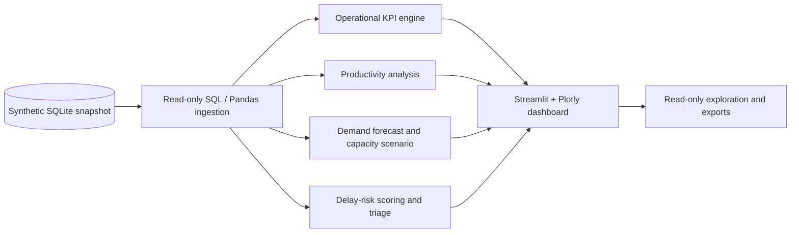

# Warehouse Operations Control Tower

**A Streamlit-based analytics and decision-support demo for warehouse and distribution-center operations.**

[**Launch the live demo**](https://warehouse-operations-control-tower-demo-pebsnzfnmcbwlxfavivd2x.streamlit.app/) · [**View the GitHub repository**](https://github.com/apiyufelix/warehouse-operations-control-tower-demo)

> **Public demonstration — synthetic data only.** The hosted application is designed for read-only exploration, not live warehouse execution. Its historical dataset is frozen at **November 12, 2026 (UTC)**. Metrics, predictions, risk scores, and suggested actions illustrate an analytics workflow; they are not operational claims about any real warehouse or employer.

## Overview

Warehouse leaders often need to combine order status, shipping deadlines, inventory, quality inspections, and labor productivity to answer a simple question: **What is happening in the distribution center, what is at risk, and where should we investigate first?**

The Warehouse Operations Control Tower brings those views into a unified dashboard. It supports retrospective performance reviews and demonstrates how historical data can inform order-volume forecasts, capacity scenarios, and explainable exception triage.

### Key capabilities

| Dashboard | What it helps users examine |
| --- | --- |
| **Executive brief** | KPI scorecard, comparisons with the previous equal-length period, warehouse performance, leadership review priorities, and downloadable reports |
| **Overview** | Orders received and shipped, on-time shipping, cycle time, backlog, and warehouse-level comparisons |
| **Overdue orders** | Open orders past their promised shipping time, filtered by warehouse and illustrative severity |
| **Quality control** | Inspection volumes, defect rates, and failed inspections |
| **Inventory** | Current SKU-level quantities and reorder-point monitoring |
| **Productivity** | Picking, packing, and dispatch output; labor hours; shift comparisons; queue-wait indicators |
| **Forecast & alerts** | 7- or 14-day demand forecasts, backtest diagnostics, workload estimates, and rule-based operational watches |
| **Delay risk & triage** | Upcoming and overdue deadlines, historical risk scores, suggested investigations, and prioritized review queues |

## Demo snapshot

The sample below reflects **both fictional warehouses** for **October 14–November 12, 2026**. These values are derived from the packaged synthetic demonstration database and **must not be interpreted as real business results**.

| Measure | Sample value |
| --- | ---: |
| Orders received during the period | 1,339 |
| Orders shipped during the period | 1,337 |
| On-time shipping, for orders due in the period | 87.14% |
| Open backlog at the reporting cutoff | 75 orders |
| Overdue open orders at the reporting cutoff | 53 orders |
| QC defect rate by inspected units | 1.73% |
| SKU–warehouse records at or below reorder point | 22 |

**Important:** Orders received, orders shipped, and orders due use different event-date definitions. They are not interchangeable counts. The backlog and inventory indicators are as-of/snapshot measures rather than sums restricted to the selected reporting window.

## Explore the live application

1. Open the [public Streamlit demo](https://warehouse-operations-control-tower-demo-pebsnzfnmcbwlxfavivd2x.streamlit.app/).
2. Use the **warehouse** and **UTC date range** filters in the sidebar.
3. Start with **Executive brief** for performance trends and review priorities.
4. Inspect **Overdue orders** and **Delay risk & triage** to see how the app separates already-late orders from approaching deadlines.
5. Review **Productivity** for process/shift differences, then try a **7- or 14-day** forecast and inspect its error diagnostics.
6. Export available CSVs or the executive brief for offline analysis.

The public interface permits exploration and downloads. It does **not** provide operational case editing, data uploads, user accounts, or warehouse-system integration.

## Architecture



**Technology:** Python, Streamlit, Pandas, Plotly, SQLite, SQL, and pytest. The public demo is deployed on Streamlit Community Cloud.

### Data model

The frozen demonstration dataset includes **2 fictional warehouses**, **40 products**, and the following operational tables:

| Table | Purpose |
| --- | --- |
| `warehouses` | Warehouse identifiers and names |
| `products` | Product/SKU reference data |
| `orders` | Order creation, promise, priority, status, and warehouse association |
| `order_lines` | Product quantities associated with orders |
| `shipments` | Order shipment timestamps |
| `inventory` | SKU-by-warehouse inventory snapshots and reorder levels |
| `quality_inspections` | Inspection outcomes and defect quantities |
| `process_activities` | Picking, packing, and dispatch activity |
| `labor_shifts` | Recorded direct labor hours by process and shift |

For example, **on-time shipping** is calculated over eligible orders **due** during the selected window: shipments made on or before the promise count as on time, and overdue unshipped orders count against the rate. **Productivity** is expressed as processed units per recorded direct labor hour. Inventory metrics use the latest appropriate snapshot rather than summing historical snapshots.

## Forecasting and risk methodology

### Demand forecasting

- Aggregates historical order intake by day and warehouse.
- Compares a **recent same-weekday pattern** with a **rolling-average approach**.
- Selects the lower-error method using a historical backtest for each warehouse.
- Reports **mean absolute error (MAE)** and **weighted absolute percentage error (WAPE)**; a heuristic error envelope illustrates typical past miss sizes.
- Translates the order forecast into **illustrative picking, packing, and dispatch labor-hour scenarios** using historical units per order and units per direct labor hour.

**Limitation:** These are forecasts on synthetic history, not validated predictions of a real distribution center. Capacity scenarios do not account for every constraint, future staffing roster, or change in operating conditions.

### Delay-risk intelligence

- Uses past order characteristics and observed late-shipment outcomes to create an **explainable historical cohort-based score**.
- Evaluates the score on held-out history, including a **Brier score** diagnostic.
- Separates **already-overdue** orders from **upcoming** deadlines; an order that is already overdue is not treated as merely having a probability of lateness.
- Shows possible contributing signals and suggested follow-up actions for human review.

**Limitation:** Scores are **not calibrated probabilities**, identified signals are **not confirmed root causes**, and recommendations are **not automated warehouse decisions**.

## Run locally

**Recommended environment:** Python 3.12, with Git installed if you plan to clone the repository.

```powershell
git clone https://github.com/apiyufelix/warehouse-operations-control-tower-demo.git
cd warehouse-operations-control-tower-demo
python -m venv .venv
.\.venv\Scripts\Activate.ps1
python -m pip install -r requirements.txt
python -m streamlit run app.py
```

Open `http://localhost:8501`. The public application expects `warehouse_ops_demo.db` alongside `app.py`. If PowerShell blocks virtual-environment activation under your organization's policy, use `.\.venv\Scripts\python.exe -m pip install -r requirements.txt` and `.\.venv\Scripts\python.exe -m streamlit run app.py` instead of changing the security policy.

### Tests

```powershell
python -m pip install pytest
python -m pytest tests -q
```

The repository's tests cover analytics components; the public demo package includes checks for its read-only database usage and absence of editing controls. A passing test suite does not substitute for deployment, security, or operational validation.

## Project files

| File | Responsibility |
| --- | --- |
| `app.py` | Streamlit page, filters, charts, and public-facing controls |
| `analytics.py` | Read-only database loading, operational KPI calculations |
| `executive.py` | Executive summaries, comparisons, and briefing export |
| `productivity.py` | Process and labor productivity analytics |
| `forecasting.py` | Forecasting, historical error tests, and capacity/alert scenarios |
| `risk_intelligence.py` | Order-risk scoring, holdout evaluation, and prioritization |
| `schema.sql` | Database schema reference, where included |
| `requirements.txt` | Application dependencies |
| `tests/` | Automated regression and reporting tests |
| `warehouse_ops_demo.db` | Synthetic SQLite snapshot used by the public app |

**Repository hygiene:** The current repository has also included development modules such as `data_ingestion.py` and `exception_workflow.py`, plus `warehouse_ops.db`. Those are **not required by the public read-only dashboard**. Before promoting the repository, audit both databases for confidentiality and remove unnecessary development assets from the public release; removing tracked files later does not erase them from Git history.

## Privacy, security, and scope

- The application is intended for a **public, synthetic-data demonstration** only.
- The hosted read-only app uses a SQLite connection opened in **read-only/immutable mode**. It is not an enterprise permission system.
- The public interface has **no data ingestion, case assignment, audit editing, or save actions**.
- There are **no live WMS/ERP connectors**, and historical records do not update in real time.
- The project does **not** establish production readiness, security certification, or realized operational improvements at an actual company.
- Never publish employer data, personal data, passwords, access tokens, or non-synthetic operations records.

## Next development opportunities

A production-oriented version would require a managed PostgreSQL database, authenticated users and role-based authorization, securely governed imports or WMS integrations, durable audit history, monitoring, backup/restore procedures, model drift checks, and a deployment/security review. These capabilities are **future work**, not features of the public demo.

## Author

**Felix Apiyu**  
[GitHub](https://github.com/apiyufelix) · [Live application](https://warehouse-operations-control-tower-demo-pebsnzfnmcbwlxfavivd2x.streamlit.app/)

*Built as a portfolio demonstration combining warehouse operations, data analytics, Python application development, and explainable decision-support methods.*
